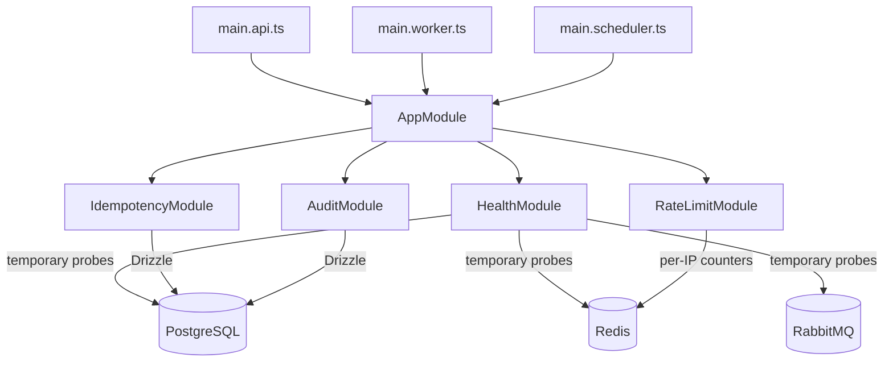
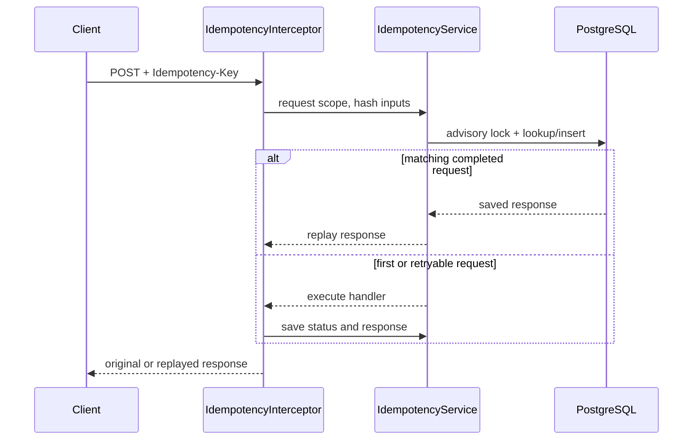

# Kova architecture: implemented work

This document records the code and infrastructure implemented so far, phase by phase. It explains how the pieces connect and what happens when the API receives a request. As each outline feature is completed, add its implementation and connections here. This is a learning log for the working system, not a description of future product architecture.

The current implementation is Phase 0, the project foundation. There are no vendor, buyer, payment, deal, ledger, or dispute APIs yet. The only HTTP route is `GET /health`.

## How the application is put together

Kova is a TypeScript NestJS modular monolith. It has three process entry points, all using the same `AppModule`:

| Process | Entry point | What it currently does |
| --- | --- | --- |
| API | [`src/main.api.ts`](../src/main.api.ts) | Starts the Express-backed Nest HTTP server, configures HTTP middleware and global guards, and serves `GET /health`. |
| Worker | [`src/main.worker.ts`](../src/main.worker.ts) | Starts the shared Nest application context and handles shutdown signals. No business consumers are connected yet. |
| Scheduler | [`src/main.scheduler.ts`](../src/main.scheduler.ts) | Starts the shared Nest application context and handles shutdown signals. No scheduled business jobs are connected yet. |

[`src/app.module.ts`](../src/app.module.ts) imports `HealthModule`, `IdempotencyModule`, `RateLimitModule`, and `AuditModule`. Shared utilities live under `src/common`; PostgreSQL schema and migration files are under `src/db`; automated checks live under `test/`.



## Phase 0, item by item

### 0.1 — Repository and tooling

The project uses pnpm, TypeScript strict mode, NestJS, ESLint, and Prettier. `src/main.api.ts`, `src/main.worker.ts`, and `src/main.scheduler.ts` are independent startup points sharing `AppModule`. Their application-creation functions are exported so tests can start the Nest apps without invoking the production `listen`/bootstrap path. [`test/smoke/entrypoints.test.ts`](../test/smoke/entrypoints.test.ts) checks all three entry points.

The `build`, `lint`, `format`, `format:check`, and `typecheck` scripts are defined in [`package.json`](../package.json). `pnpm-lock.yaml` pins the dependency graph.

### 0.2 — Local services and application containers

The root [`compose.yaml`](../compose.yaml) describes the local PostgreSQL, Redis, RabbitMQ, Mailpit, migration, API, worker, and scheduler services. [`Dockerfile`](../Dockerfile) builds the application image. Compose supplies service URLs and credentials through environment variables; the migration service runs before the application processes. Data services use named volumes and health checks, and published ports are loopback-bound.

This is the local development stack. The app's health endpoint probes PostgreSQL, Redis, and RabbitMQ, so a healthy HTTP response also reports whether those configured dependencies answered. The successful local Docker check returned HTTP 200 when all three were up.

### 0.3 — Startup configuration

[`src/common/config/env-config.ts`](../src/common/config/env-config.ts) validates environment variables with Zod. `loadRuntimeConfig()` validates the common process settings; `loadApiConfig()` adds API-only settings and parsed values. Invalid values stop startup with a configuration error. Configuration is loaded by each process entry point, with API-specific parsing in `main.api.ts`.

`.env.example` documents local variables and `.gitignore` excludes `.env`. The package scripts load `.env` when present; environment variables already supplied by the process take precedence.

### 0.4 — PostgreSQL and migrations

[`src/db/database.ts`](../src/db/database.ts) creates the Drizzle database connection. The forward-only migration [`0000_foundation.sql`](../src/db/migrations/0000_foundation.sql) creates the two foundation tables:

- `idempotency_keys` stores a request scope/key, request hash, saved response, and expiry.
- `audit_log` stores actor/action/entity details, optional before/after JSON, optional IP, and creation time. A database trigger rejects updates and deletes.

The matching Drizzle table definitions are in [`src/db/schema/index.ts`](../src/db/schema/index.ts). `pnpm db:migrate` applies migrations. Tests use a generated isolated database through [`test/helpers/test-database.ts`](../test/helpers/test-database.ts); the Testcontainers runner starts disposable dependencies for integration and e2e suites.

### 0.5 — Logging, correlation IDs, and API errors

[`src/common/logger/logger.ts`](../src/common/logger/logger.ts) adapts Pino to Nest logging and configures redaction for sensitive values. [`correlation-id.middleware.ts`](../src/common/correlation/correlation-id.middleware.ts) accepts a valid UUID correlation ID or creates one, stores it in request context, and returns it in the `x-correlation-id` response header. The logger reads that context so related log records can be traced together.

[`src/common/errors/api-exception.filter.ts`](../src/common/errors/api-exception.filter.ts) converts handled errors into the shared response shape: error code, message, details, and correlation ID. Body parser and validation failures are mapped to stable safe error codes. Tests cover logging redaction, correlation IDs, and error formatting.

### 0.6 — Integer money helpers

[`src/common/money/kobo.ts`](../src/common/money/kobo.ts) defines the `Kobo` integer type and helpers for addition, subtraction, basis-point multiplication with half-up rounding, and display formatting. These utilities do not use floating-point money values. Unit and fast-check property tests cover arithmetic and invariants. No fees or ledger operations use these helpers yet.

### 0.7 — POST idempotency

`IdempotencyModule` provides `IdempotencyService` and a global Nest interceptor. On a POST, [`idempotency.interceptor.ts`](../src/common/idempotency/idempotency.interceptor.ts) checks the `Idempotency-Key` header and passes method, route, query, and body information to the service. [`idempotency.service.ts`](../src/common/idempotency/idempotency.service.ts) hashes the request, uses a PostgreSQL advisory lock to serialize concurrent use of a scope/key, and stores the response in `idempotency_keys`.

Repeating the same key and request replays the saved response. Reusing the key for a different request conflicts. Completed entries expire after 48 hours; eligible failures can be retried according to the service's rules. Non-POST requests pass through. Unit and database integration tests cover replay, mismatch, expiry, and concurrency behavior.



### 0.8 — Foundation security and throttling

The initial security foundation introduced Redis-backed throttling, Helmet, CORS, request body limits, and DTO validation. Item 0.11 extends these foundations with configurable route profiles and explicit startup behavior; the complete current request configuration is described in [0.11](#011--application-level-guardrails).

### 0.9 — Test tooling and CI

The test stack combines Node's test runner, Jest, Supertest, Testcontainers, and fast-check. `pnpm test` runs unit/migration checks; `pnpm test:integration` runs integration tests with real disposable PostgreSQL, Redis, and RabbitMQ services; `pnpm test:e2e` runs the HTTP e2e suite. [`test/helpers/run-testcontainers.ts`](../test/helpers/run-testcontainers.ts) coordinates containers and test execution.

The GitHub Actions workflow [`.github/workflows/ci.yml`](../.github/workflows/ci.yml) installs from the frozen lockfile and runs lint, typecheck, tests, dependency audit, and image build checks. These checks have passed in CI on the project commit documented in the prior change history. The owner maintains the workflow and container build files.

### 0.10 — Audit log service

`AuditModule` exports `AuditService` to the rest of the Nest application. Its database connection in [`audit.database.ts`](../src/modules/audit/audit.database.ts) is opened lazily on the first database operation and closed when the module is destroyed. The table is defined in [`src/db/schema/audit-log.ts`](../src/db/schema/audit-log.ts) and created by the foundation migration.

The write path is:

1. A caller passes an audit input to `AuditService.record(...)`. The input describes actor, action, entity, optional before/after state, and optional IP.
2. [`audit.validation.ts`](../src/modules/audit/audit.validation.ts) checks fields and bounds. Invalid inputs produce a safe bad-request error.
3. [`audit.redaction.ts`](../src/modules/audit/audit.redaction.ts) removes sensitive keys from before/after data before persistence. Non-JSON-serializable state is rejected.
4. The service inserts through Drizzle into `audit_log`. If the caller passes its Drizzle transaction, the audit row participates in that transaction; otherwise the service uses its own database connection.
5. PostgreSQL's trigger prevents editing or deleting the inserted row.

`AuditService.findByEntity(entity, entityId, limit)` reads the latest matching records, validates the query, and caps the result size. The service itself has no update/delete methods. [`test/unit/audit-service.test.ts`](../test/unit/audit-service.test.ts) covers validation and redaction; [`test/jest/integration/audit-service.spec.ts`](../test/jest/integration/audit-service.spec.ts) verifies inserts, transactional behavior, queries, and append-only enforcement against PostgreSQL.

At this foundation stage, the module provides the service for future callers; no business module has been added to generate audit records yet.

### 0.11 — Application-level guardrails

The API bootstrap in [`main.api.ts`](../src/main.api.ts) disables Nest's automatic body parser and calls [`configureApiHttp`](../src/common/security/api-http-setup.ts). That function configures Express and Nest in this order:

1. Apply the validated Express `trust proxy` value.
2. Install Helmet; HSTS is disabled outside production.
3. Configure exact-origin CORS with explicit methods and headers, and credentials disabled.
4. Install correlation-ID middleware.
5. Install JSON and URL-encoded parsers with route-aware limits, then parser error handling.
6. Register the global exception filter and validation pipe.

After Express parsing, Nest handles the request. The global throttler guard runs before interceptors and pipes; the idempotency interceptor runs before DTO pipes and the controller. The current health controller skips throttling so it can report Redis outages.

#### Rate-limit profiles

`RateLimitModule` registers the default and named profiles with `@nestjs/throttler`. [`ThrottleProfile`](../src/common/rate-limit/throttle-profile.decorator.ts) selects a route's profile; unmarked routes use `default`. [`RedisThrottlerStorage`](../src/common/rate-limit/redis-throttler.storage.ts) stores atomic counters in Redis, and [`RedisThrottlerGuard`](../src/common/rate-limit/redis-throttler.guard.ts) applies the selected profile and outage policy.

| Profile | Default limit | Default window | Redis unavailable |
| --- | ---: | ---: | --- |
| `default` | 60 requests | 60 seconds | Fail closed |
| `auth` | 5 requests | 60 seconds | Fail open |
| `otp` | 3 requests | 5 minutes | Fail closed |
| `payment` | 10 requests | 60 seconds | Fail closed |
| `dispute` | 3 requests | 60 seconds | Fail closed |

Each profile's limit and window can be overridden through environment configuration. A blocked request returns HTTP 429, the `RATE_LIMITED` code, and `Retry-After`. These profiles are ready to be applied to routes; there are no auth, OTP, payment, or dispute controllers yet.

#### Request parsing, validation, and client metadata

- `BODY_LIMIT_BYTES` sets the default parsed JSON/form body maximum (100 KiB by default). `BODY_LIMIT_OVERRIDES` accepts comma-separated `path-prefix=bytes` entries; the longest matching prefix wins. Each override is capped at 100 MiB. [`request-body-parser.ts`](../src/common/security/request-body-parser.ts) applies the parser and oversized bodies return HTTP 413.
- `CORS_ORIGIN` is a comma-separated list of exact HTTP(S) origins. Invalid origins, wildcards, and URL paths are rejected during config parsing.
- [`validation-pipe.ts`](../src/common/security/validation-pipe.ts) globally transforms DTOs, whitelists declared fields, rejects unknown fields, and disables implicit conversion. Failures use `VALIDATION_ERROR` without echoing submitted values. The current health route has no DTO.
- `TRUST_PROXY` defaults to off. It accepts a hop count from 0 to 10 or explicit IP/CIDR and Express local-network names; `true` is rejected. Express uses this setting to derive `req.ip` when deployed behind a trusted load balancer.
- [`request-metadata.ts`](../src/common/security/request-metadata.ts) exposes `req.ip` and a user-agent value truncated to 512 characters. IP and user agent are metadata for rate limiting and fraud/audit context, never identity or a pass/fail check. Buyer identity, when buyer flows are implemented, is the normalized email.

Unit tests in [`test/unit/http-guardrails.test.ts`](../test/unit/http-guardrails.test.ts) exercise the HTTP behavior with test-only routes; [`test/unit/guardrail-config.test.ts`](../test/unit/guardrail-config.test.ts) covers configuration parsing. Redis behavior is checked against a real Redis container in [`test/jest/integration/redis-throttling.spec.ts`](../test/jest/integration/redis-throttling.spec.ts).

## Current HTTP request path

The public API currently exposes only `GET /health`. The path below shows the shared middleware and guards that any API route encounters:

```mermaid
sequenceDiagram
  participant Client
  participant Express
  participant Guard as RedisThrottlerGuard
  participant Idem as IdempotencyInterceptor
  participant Pipe as ValidationPipe
  participant Health as HealthController
  participant Service as HealthService
  Client->>Express: HTTP request
  Express->>Express: proxy IP, Helmet, CORS, correlation ID, body parsing
  Express->>Guard: parsed request
  Guard->>Guard: selected profile + request.ip
  Guard->>Idem: allowed request
  Idem->>Pipe: non-POST pass-through / POST idempotency
  Pipe->>Health: GET /health
  Health->>Service: check()
  Service->>Service: PostgreSQL, Redis, RabbitMQ probes
  Service-->>Health: dependency statuses
  Health-->>Client: 200 if all up, otherwise 503; correlation header included
```

[`HealthController`](../src/modules/health/health.controller.ts) is marked `@SkipThrottle()`. [`HealthService`](../src/modules/health/health.service.ts) checks PostgreSQL, Redis, and RabbitMQ concurrently using short-lived clients and one-second timeouts. It reports each dependency as `up` or `down`; the controller returns 200 only when all are up and 503 otherwise. Errors from individual probes are converted into `down` statuses.

## Foundation data and module boundaries

| Table | Writer/reader | Current behavior |
| --- | --- | --- |
| `idempotency_keys` | `IdempotencyService` | Saves request hashes and replayable responses; supports expiry cleanup and retry behavior. |
| `audit_log` | `AuditService` | Inserts redacted audit records and queries by entity; database trigger blocks update/delete. |

The application-level rule is that each feature uses its own module/service boundary. At present, `IdempotencyModule` owns idempotency operations, `AuditModule` owns audit operations, `RateLimitModule` owns the Redis throttle integration, and `HealthModule` owns dependency checks. `AppModule` composes them; it does not contain business logic.

## Where the implementation is verified

| Concern | Tests |
| --- | --- |
| Startup configuration and guardrail env parsing | `test/unit/env-config.test.ts`, `test/unit/guardrail-config.test.ts` |
| Logging, correlation, and errors | `test/unit/logger.test.ts`, `test/unit/api-exception.filter.test.ts` |
| Money helpers | `test/unit/kobo.test.ts`, `test/jest/unit/kobo.property.spec.ts` |
| Idempotency and migrations | `test/unit/idempotency.test.ts`, `test/integration/idempotency.test.ts`, `test/integration/migrations.test.ts` |
| HTTP guardrails and health | `test/unit/http-guardrails.test.ts`, `test/unit/health.test.ts`, `test/jest/e2e/health.spec.ts` |
| Audit persistence and Redis throttling | `test/jest/integration/audit-service.spec.ts`, `test/jest/integration/redis-throttling.spec.ts` |
| Process startup | `test/smoke/entrypoints.test.ts` |

Use `pnpm test`, `pnpm test:integration`, and `pnpm test:e2e` for the corresponding suites. Integration and e2e tests require Docker to be available for Testcontainers.

## Change log

- 2026-11-09 — Implemented the transactional append-only audit service and application-level guardrails; verified with unit, Testcontainers integration, and e2e suites.
- 2026-11-09 — Reworked this document to explain only implemented Phase 0 work, emphasizing item 0.10's audit-service flow and how the foundation modules communicate. Removed planned product-flow walkthroughs and future architecture descriptions.
