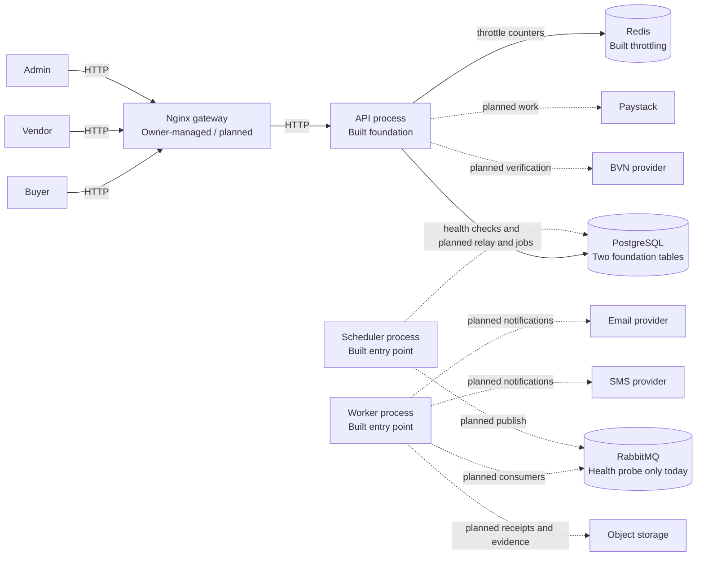
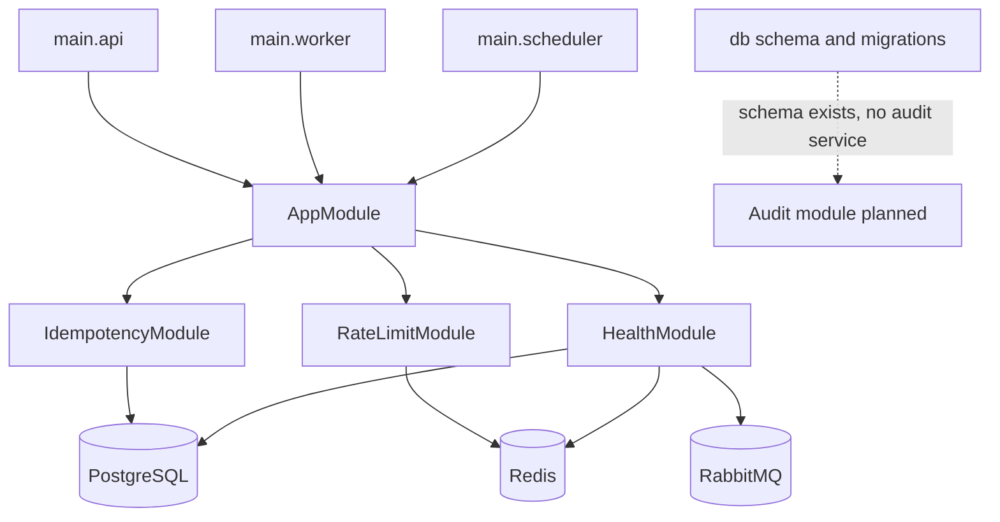
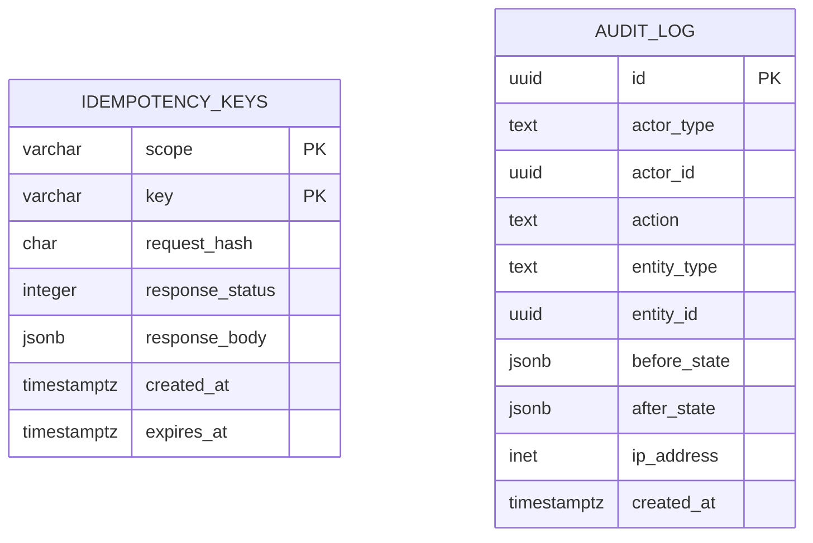
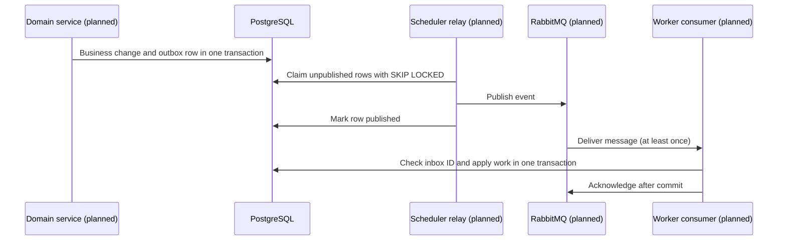
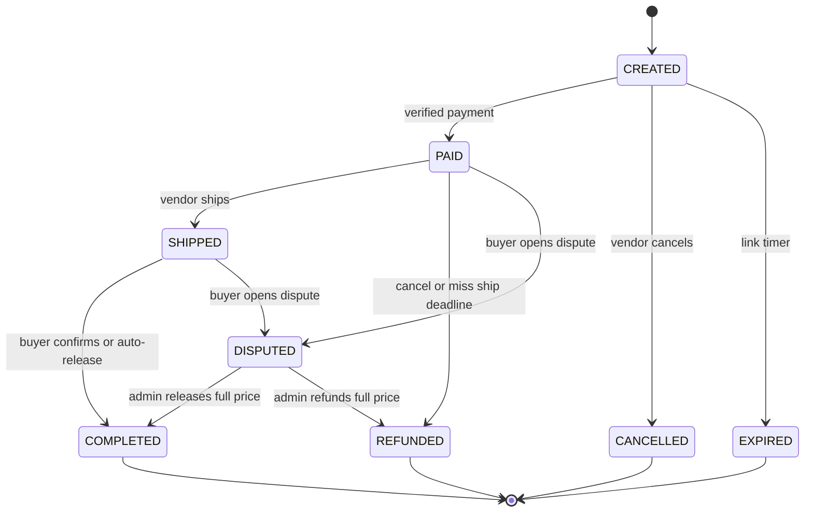
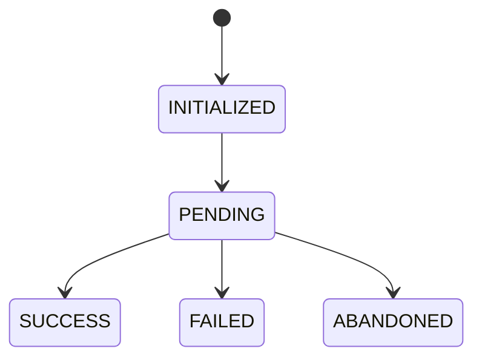
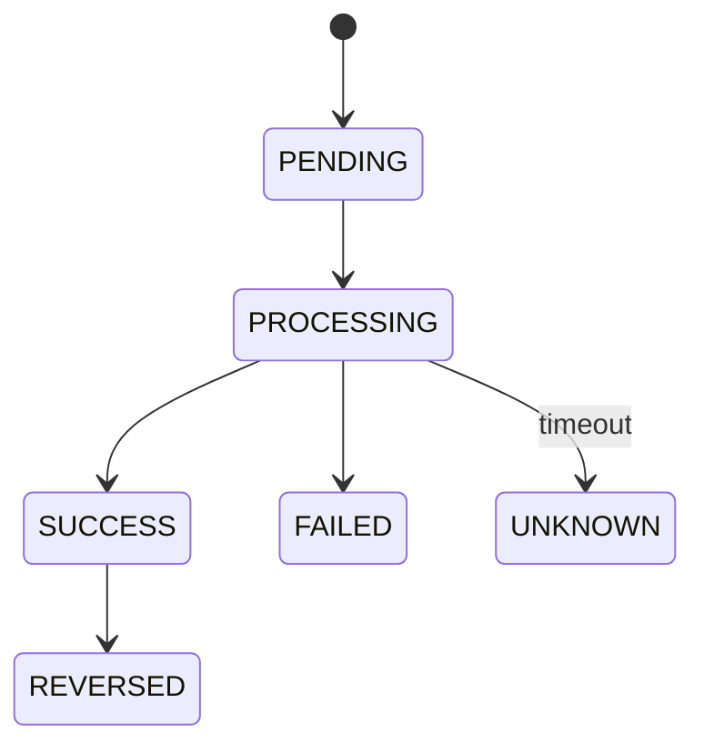
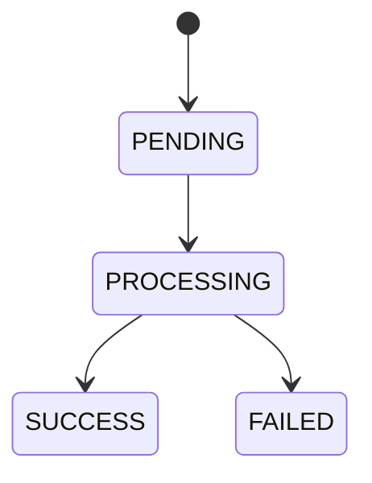

# Kova architecture

Last verified against commit `48ff96f` on `2026-11-08`.

The working tree contains Phase 0.9 test-tooling changes and the owner-authorized Phase 0.2 Compose/Docker and 0.9 CI implementation. Status below reflects the inspected working tree.

## 1. How to read this document

This is the working map of Kova’s code: what exists, how requests move, and which planned parts are not built yet. Code is the authority for current behavior; [AGENTS.md](../AGENTS.md) and [OUTLINE.md](../OUTLINE.md) are the authority for rules and future work.

Status labels mean:

- **Built** — present in the repository and usable.
- **In progress** — some implementation exists, but the feature or its verification is incomplete.
- **Planned** — described in the outline or project rules, but not implemented.
- **Owner-managed** — infrastructure or a decision reserved for the owner.

When a feature changes a flow, diagram, event, job, table, environment variable, or concept, update this document in the same change. Update the section that explains it, add a glossary entry for a new term, and add a line to the change log. At each phase checkpoint, say what changed here. Verify links and diagrams against code; mark unknown details `TODO: confirm` instead of filling gaps by assumption.

## 2. The big picture

**Built:** Kova currently runs as a NestJS modular monolith with separate API, worker, and scheduler entry points. The API has a health endpoint, PostgreSQL-backed idempotency support, Redis-backed throttling, request validation, security headers, correlation IDs, and structured logs. The worker and scheduler currently boot the same small Nest application context; they do not yet consume or schedule business work.

**Planned:** buyer and vendor deal flows, Paystack, verification providers, the ledger, message processing, notifications, receipts, and reconciliation. The Nginx gateway and production infrastructure remain owner-managed.

**Built:** Phase 0.2 Compose and Dockerfiles build successfully; the full local stack starts, and `GET /health` returns HTTP 200 with PostgreSQL, Redis, and RabbitMQ up. The migration container must receive all three service URLs because it loads the shared runtime configuration.

**Built:** Phase 0.9 test tooling, a URL-normalizing e2e helper, and GitHub Actions CI are implemented. Lint, typecheck, unit/migration, Testcontainers integration, e2e, dependency audit, and image build all passed on GitHub Actions for commit `48ff96f`. The local dependency audit could not reach npm's advisory endpoint (timeout); GitHub's audit gate passed.



_Caption: solid arrows show current HTTP or dependency checks; dotted arrows are planned integration paths, not implemented connections._

## 3. The three processes

| Process   | What it does now                                                                                                      | Start command                                         | Why it is separate                                                                                      |
| --------- | --------------------------------------------------------------------------------------------------------------------- | ----------------------------------------------------- | ------------------------------------------------------------------------------------------------------- |
| API       | Starts the Nest HTTP app, security middleware, health route, global throttle guard, and POST idempotency interceptor. | `pnpm start:api` → `dist/src/main.api.js`             | Handles request/response traffic and can scale independently.                                           |
| Worker    | Creates a Nest application context and installs shutdown hooks. No consumers exist yet.                               | `pnpm start:worker` → `dist/src/main.worker.js`       | Planned to handle slow payment, payout, refund, notification, and receipt work outside an HTTP request. |
| Scheduler | Creates a Nest application context and installs shutdown hooks. No poller or scheduled job exists yet.                | `pnpm start:scheduler` → `dist/src/main.scheduler.js` | Planned to relay outbox rows and poll due jobs without tying that work to API uptime.                   |

All three use [`AppModule`](../src/app.module.ts), which currently imports `HealthModule`, `IdempotencyModule`, and `RateLimitModule`. The API uses `createApiApplication`; worker and scheduler use `NestFactory.createApplicationContext`. Each bootstrap validates runtime environment configuration and installs the Pino Nest logger. The application-context functions can also be called by tests without running the corresponding `bootstrap...` function.

All processes expect PostgreSQL, Redis, and RabbitMQ URLs at startup. Today, idempotency opens its own PostgreSQL pool, rate limiting opens its own Redis client, and health probes use short-lived clients. The RabbitMQ client is used only by the health probe. The three processes are entry points, not yet three different business applications.

## 4. Module map

### Existing module and data ownership map

| Module or area                                                                                                                                                                                                                   | Purpose                                                                         | Tables it owns now                            | What it exposes                                      | Depends on                           | Status                        |
| -------------------------------------------------------------------------------------------------------------------------------------------------------------------------------------------------------------------------------- | ------------------------------------------------------------------------------- | --------------------------------------------- | ---------------------------------------------------- | ------------------------------------ | ----------------------------- |
| `modules/health`                                                                                                                                                                                                                 | `GET /health`, probing the three configured dependencies                        | None                                          | Health report and endpoint                           | PostgreSQL, Redis, RabbitMQ          | Built                         |
| `common/idempotency`                                                                                                                                                                                                             | Require and process an idempotency key on every POST                            | `idempotency_keys`                            | Global Nest interceptor and service                  | PostgreSQL                           | Built                         |
| `common/rate-limit`                                                                                                                                                                                                              | Count and block requests using Redis                                            | None                                          | Global Nest throttler guard and storage adapter      | Redis, `@nestjs/throttler`           | Built; real Redis test passes |
| `common/config`                                                                                                                                                                                                                  | Validate runtime and API configuration with Zod                                 | None                                          | `loadRuntimeConfig`, `loadApiConfig`                 | Environment                          | Built                         |
| `common/correlation`, `common/logger`, `common/errors`, `common/security`, `common/money`                                                                                                                                        | Shared request context, logs, errors, input/security setup, and kobo arithmetic | None                                          | Middleware, logger, filter, pipe, constants, helpers | Nest, Express, Pino, Node            | Built                         |
| `db`                                                                                                                                                                                                                             | Drizzle schema, database factory, SQL migrations                                | Schema for `audit_log` and `idempotency_keys` | `createDatabase`, schemas, migrations                | PostgreSQL                           | Built foundation              |
| `modules/audit`                                                                                                                                                                                                                  | Write/query audit records                                                       | `audit_log` schema exists                     | No service or module yet                             | PostgreSQL                           | Planned; schema only          |
| `auth`, `vendors`, `payout-accounts`, `deals`, `fees`, `payments`, `payouts`, `refunds`, `disputes`, `ledger`, `webhooks`, `messaging`, `scheduler`, `notifications`, `receipts`, `admin`, `providers/paystack`, `providers/kyc` | Business modules described in project scope                                     | No tables or module code yet                  | None yet                                             | Planned dependencies in `OUTLINE.md` | Planned                       |

### Dependency diagram



_Caption: this shows current Nest module imports and connection checks; planned business-module arrows are intentionally omitted._

The boundary rules in [AGENTS.md](../AGENTS.md) say each module should write only its own tables, the ledger alone should write ledger tables, and the deal state service alone should change deal status. These boundaries are **Planned**: there is no ledger, deal, or audit service yet. Current enforcement is limited to `AppModule` imports and the use of separate schema files. There is no repository-level rule or database role preventing other code from writing a table. The audit table does have a database trigger blocking update and delete.

## 5. Life of an API request

The current API has only `GET /health`. No authentication guard, business controller, or DTO-backed business route exists yet. The order below follows [`main.api.ts`](../src/main.api.ts) and Nest’s request lifecycle.

```mermaid
sequenceDiagram
  participant C as Client
  participant E as Express middleware
  participant G as Throttler guard
  participant I as Idempotency interceptor
  participant V as Validation pipe
  participant H as Health controller
  participant S as Health service
  participant D as Dependencies

  C->>E: HTTP request
  Note over E: Helmet, CORS, correlation ID, body parsing
  E->>G: Parsed request
  G->>D: Redis increment for route/IP key
  D-->>G: Count and block state
  G->>I: Continue if permitted
  Note over I: POST requests require Idempotency-Key; other methods pass through
  I->>V: Continue
  Note over V: DTO validation is configured globally; health has no DTO
  V->>H: GET /health
  H->>S: Check dependencies
  S->>D: PostgreSQL, Redis, RabbitMQ probes
  D-->>S: Up/down results
  S-->>H: Health report
  H-->>C: 200 or 503 plus correlation header
```

_Caption: the guard runs before interceptors and pipes; the health route skips throttling so Redis failure does not hide health status._

1. Express registers Helmet and CORS first, then correlation-ID middleware, then JSON and URL-encoded body parsers, then a parser-error middleware.
2. Nest’s global throttler guard checks Redis. `GET /health` is annotated `@SkipThrottle()`; other current routes are throttled using `request.ip`.
3. The global idempotency interceptor passes non-POST requests through. POST requests must include a valid `Idempotency-Key`; it hashes method, route template, query, and body.
4. The global validation pipe transforms DTOs, whitelists known fields, rejects unknown fields, and disables implicit conversion. There are no DTO-backed business routes yet.
5. Authentication, authorization, controllers for business actions, and domain services are **Planned**. The health controller calls the health service directly.
6. The exception filter returns the standard safe error shape. The correlation ID is included in the response header and filter output.

Files: [`src/main.api.ts`](../src/main.api.ts), [`correlation-id.middleware.ts`](../src/common/correlation/correlation-id.middleware.ts), [`rate-limit.module.ts`](../src/common/rate-limit/rate-limit.module.ts), [`idempotency.interceptor.ts`](../src/common/idempotency/idempotency.interceptor.ts), [`validation-pipe.ts`](../src/common/security/validation-pipe.ts), [`health.controller.ts`](../src/modules/health/health.controller.ts), [`health.service.ts`](../src/modules/health/health.service.ts), [`api-exception.filter.ts`](../src/common/errors/api-exception.filter.ts).

## 6. Data model

The only current application tables are created by [`0000_foundation.sql`](../src/db/migrations/0000_foundation.sql) and represented in [`src/db/schema`](../src/db/schema/index.ts).

| Table              | Intended owner          | Key columns and relationships                                                                                                | Mutation policy                                                                                          | Status                        |
| ------------------ | ----------------------- | ---------------------------------------------------------------------------------------------------------------------------- | -------------------------------------------------------------------------------------------------------- | ----------------------------- |
| `idempotency_keys` | `common/idempotency`    | Composite primary key `(scope, key)`; stores request hash, response status/body, creation and expiry times. No foreign keys. | Mutable: completed response is updated; expired rows and eligible failed requests are deleted.           | Built                         |
| `audit_log`        | Planned `modules/audit` | UUID id; actor type/id; action; entity type/id; before/after JSONB; IP; creation time. No foreign keys.                      | PostgreSQL trigger rejects `UPDATE` and `DELETE`; inserts are allowed. The app has no audit service yet. | Built schema; service planned |

The migration adds indexes for audit entity/time queries and idempotency expiry cleanup. It does not define ledger, deal, vendor, payment, outbox, inbox, webhook, or scheduled-job tables. No correlation-ID column exists in `audit_log`.



_Caption: the foundation tables are independent today; business foreign keys and ledger relationships are planned._

## 7. Core flows

The product flows below are part of the plan, not current runtime behavior. Their authoritative requirements and planned acceptance tests are linked in [OUTLINE.md](../OUTLINE.md) and [AGENTS.md](../AGENTS.md). A planned stub is deliberately short so it cannot be mistaken for implemented code.

### Vendor registration and verification — Planned

Register a vendor, verify an email or phone, then verify BVN identity against the resolved bank account before activation. No vendor or KYC module exists. See [Phase 1](../OUTLINE.md#phase-1-accounts-and-vendor-onboarding).

### Deal creation — Planned

Create a deal only for an active vendor, calculate fee and total on the server, and store a hashed public-link token. No deal table or endpoint exists. See [Phase 2](../OUTLINE.md#phase-2-core-money-logic).

### Payment start — Planned

The buyer opens a deal link and starts Paystack checkout, with transfer first and card as a secondary option. No buyer, payment, or provider code exists. See [Phase 3](../OUTLINE.md#phase-3-payments-and-messaging).

### Webhook intake and payment confirmation — Planned

The planned webhook verifies the raw-body signature, records the event, responds quickly, then lets a worker verify the transaction with Paystack before moving money. No webhook route or worker exists. See [Phase 3](../OUTLINE.md#phase-3-payments-and-messaging) and [AGENTS.md §7](../AGENTS.md).

### Ship, confirm, and release — Planned

The vendor marks shipment; the buyer confirms receipt; a controlled state transition releases item price to the vendor’s available ledger balance. No deal state machine or ledger exists. See [Phase 2](../OUTLINE.md#phase-2-core-money-logic) and [Phase 4](../OUTLINE.md#phase-4-payouts).

### Timers — Planned

The plan expires payment links, tracks ship deadlines, and auto-releases 48 hours after the delivery window unless the deal is disputed. No scheduled-jobs table or poller exists. See [Phase 3](../OUTLINE.md#phase-3-payments-and-messaging).

### Payout — Planned

The system will save a unique payout reference before calling Paystack, wait for a webhook, and resolve unknown outcomes by reference before any retry. No payout module or Paystack provider exists. See [Phase 4](../OUTLINE.md#phase-4-payouts).

### Refund — Planned

Refund the item price only; the service fee is retained. A refund needs a reason and its own state machine. No refund module or refund table exists. See [Phase 5](../OUTLINE.md#phase-5-refunds-and-disputes).

### Dispute — Planned

The buyer proves email ownership with a one-time code, submits a dispute and evidence, and an admin resolves it with a full release or full item-price refund. No dispute or admin flow exists. See [Phase 5](../OUTLINE.md#phase-5-refunds-and-disputes).

### Receipts and notifications — Planned

The worker will generate fixed-template PDFs and send email/SMS notifications with retry behavior. No receipt, notification, storage, or provider code exists. See [Phase 6](../OUTLINE.md#phase-6-receipts-notifications-reconciliation-and-operations).

### Reconciliation and sweepers — Planned

The scheduler will compare the ledger’s Paystack cash balance with Paystack and inspect stuck payments, payouts, refunds, and outbox work. No ledger, Paystack client, reconciler, or sweeper exists. See [Phase 6](../OUTLINE.md#phase-6-receipts-notifications-reconciliation-and-operations).

### Built foundation behavior

| Behavior       | What happens                                                                                                                                               | Tests                                                                                                                                                                                                                                                                                      |
| -------------- | ---------------------------------------------------------------------------------------------------------------------------------------------------------- | ------------------------------------------------------------------------------------------------------------------------------------------------------------------------------------------------------------------------------------------------------------------------------------------ |
| Health         | `/health` checks Postgres, Redis, and RabbitMQ and returns `200` or `503`.                                                                                 | [`test/unit/health.test.ts`](../test/unit/health.test.ts), [`test/jest/e2e/health.spec.ts`](../test/jest/e2e/health.spec.ts) (currently fails before the HTTP request because the test container returns a `postgres://` URL rejected by config).                                          |
| Idempotency    | PostgreSQL advisory lock serializes use of one scope/key; completed JSON responses replay; mismatched request hashes conflict; keys expire after 48 hours. | [`test/integration/idempotency.test.ts`](../test/integration/idempotency.test.ts), [`test/unit/idempotency.test.ts`](../test/unit/idempotency.test.ts).                                                                                                                                    |
| Throttling     | Redis Lua script increments and blocks atomically; route decorator can override the global default.                                                        | [`test/unit/redis-throttler.test.ts`](../test/unit/redis-throttler.test.ts), [`test/unit/throttle-guard.test.ts`](../test/unit/throttle-guard.test.ts), [`test/jest/integration/redis-throttling.spec.ts`](../test/jest/integration/redis-throttling.spec.ts) (passes against real Redis). |
| Money and logs | Kobo helpers use `bigint`; logger adds correlation IDs and censors configured sensitive field names.                                                       | [`test/unit/kobo.test.ts`](../test/unit/kobo.test.ts), [`test/jest/unit/kobo.property.spec.ts`](../test/jest/unit/kobo.property.spec.ts), [`test/unit/logger.test.ts`](../test/unit/logger.test.ts).                                                                                       |

## 8. Messaging

**Built:** the API health service can connect to RabbitMQ to test availability.

**Planned:** domain events will be committed to an outbox table in the same PostgreSQL transaction as a business change. The scheduler will publish them to RabbitMQ. A worker consumer will record message IDs in an inbox table as part of its work so duplicate deliveries can be skipped. Retry queues, dead-letter queues, and consumers do not exist yet.



_Caption: every arrow except the health check is a planned path; the current repository has no outbox, inbox, relay, queue topology, or business consumer._

| Event name        | Produced by                         | Consumed by                                     | Triggers                                   | Status  |
| ----------------- | ----------------------------------- | ----------------------------------------------- | ------------------------------------------ | ------- |
| `deal.paid`       | Planned payment-confirmation worker | Planned vendor notification and downstream work | Described in Phase 3.6                     | Planned |
| Other event names | Not yet defined in current code     | Not yet defined                                 | Add when the event contract is implemented | Planned |

## 9. Background jobs and scheduler

The scheduler entry point exists, but it currently only boots `AppModule`. It does not poll tables or connect to RabbitMQ for publishing. Planned jobs use Postgres as the source of truth; workers must re-check state before acting.

| Job                            | Trigger                        | Planned action and safety check                                      | Status  |
| ------------------------------ | ------------------------------ | -------------------------------------------------------------------- | ------- |
| Payment-link expiry            | Stored expiry time             | Expire only a still-created deal.                                    | Planned |
| Ship deadline                  | Stored delivery window         | Re-check the deal before triggering the specified refund path.       | Planned |
| Auto-release                   | 48 hours after delivery window | Re-check deal state; never release a disputed deal.                  | Planned |
| Reminders                      | Stored reminder time           | Send through the notification queue.                                 | Planned |
| Outbox relay                   | Scheduler polling loop         | Claim batches using `FOR UPDATE SKIP LOCKED`; publish and mark them. | Planned |
| Payment/payout/refund sweepers | Polling schedule               | Query provider before resolving stuck or unknown outcomes.           | Planned |
| Daily reconciliation           | Daily schedule                 | Compare platform cash with Paystack and report differences.          | Planned |

No job table exists yet. These jobs are defined in [AGENTS.md §8](../AGENTS.md) and [Phases 3, 4, and 6](../OUTLINE.md).

## 10. State machines

All state diagrams in this section are **Planned**. There is no `DealStateService`, payment, payout, or refund state code in the repository yet. The source of allowed transitions is [AGENTS.md §6](../AGENTS.md).



_Caption: deal states and triggers are specified, but no runtime transition currently enforces them._



_Caption: this planned payment machine has no source module or transition service yet._



_Caption: payout `UNKNOWN` requires a provider lookup by reference before deciding what to do; the machine is planned._



_Caption: refund transitions are specified but not implemented._

Conditional updates, transition events, and concurrency handling are planned for `DealStateService`; no current file enforces these transitions. See [Phase 2.5](../OUTLINE.md#phase-2-core-money-logic).

## 11. The ledger

The ledger is **Planned**. No ledger tables, service, posting code, database constraints, or ledger tests exist. PostgreSQL currently has only the two foundation tables listed in §6.

Planned accounts are per-vendor `held` and `available`, plus platform `paystack_cash`, `revenue`, `provider_fees`, `payout_in_transit`, and `refund_in_transit`. For a ₦5,000 item, ₦250 service fee, and ₦179 Paystack fee, the planned payment entry debits `paystack_cash` ₦5,071 and `provider_fees` ₦179; it credits vendor `held` ₦5,000 and `revenue` ₦250.

| Event                    | Debit                                                                                | Credit                                              |
| ------------------------ | ------------------------------------------------------------------------------------ | --------------------------------------------------- |
| Buyer payment            | `paystack_cash` (buyer total less provider fee); `provider_fees` (real provider fee) | Vendor `held` (item price); `revenue` (service fee) |
| Release                  | Vendor `held`                                                                        | Vendor `available`                                  |
| Payout starts            | Vendor `available`                                                                   | `payout_in_transit`                                 |
| Payout succeeds          | `payout_in_transit`                                                                  | `paystack_cash`                                     |
| Payout fee/stamp duty    | `provider_fees`                                                                      | `paystack_cash`                                     |
| Payout fails or reverses | `payout_in_transit`                                                                  | Vendor `available`                                  |
| Refund requested         | Vendor `held`                                                                        | `refund_in_transit`                                 |
| Refund processed         | `refund_in_transit`                                                                  | `paystack_cash`                                     |
| Refund fails             | `refund_in_transit`                                                                  | Vendor `held`                                       |

The project rules require every entry set to balance, unique transaction references, account row locks, non-negative vendor balances, append-only rows, and daily reconciliation. None has runtime enforcement yet. The current audit table is append-only through a database trigger; that is not a ledger implementation. See [Phase 2.2–2.3](../OUTLINE.md#phase-2-core-money-logic) and [AGENTS.md §5](../AGENTS.md).

## 12. Paystack integration

**Planned:** Paystack access must be behind a `PaymentProvider` interface. The plan lists transaction initialization and verification, bank-account resolution, recipient creation, transfers, and item-price refunds. Webhook signatures must be checked against the raw body, and money movement must wait for provider verification.

**Built:** no Paystack package, interface, provider, webhook controller, or payment table exists. RabbitMQ health checking is unrelated to payment integration. See [AGENTS.md §7](../AGENTS.md) and [Phase 3](../OUTLINE.md#phase-3-payments-and-messaging).

## 13. Security map

This table maps each hard rule in [AGENTS.md](../AGENTS.md) to current enforcement. “Planned” means the rule is documented but its business feature is not in code yet.

| Rule                                                                                      | Current enforcement                                                                                                                                              | Evidence or status                                                                                 |
| ----------------------------------------------------------------------------------------- | ---------------------------------------------------------------------------------------------------------------------------------------------------------------- | -------------------------------------------------------------------------------------------------- |
| 1. Money is integer kobo                                                                  | `Kobo` is a branded `bigint`; checked construction and arithmetic.                                                                                               | `src/common/money/kobo.ts`; `test/unit/kobo.test.ts`.                                              |
| 2. Ledger append-only, balanced, idempotent; ledger module alone writes it                | No ledger exists.                                                                                                                                                | Planned; Phase 2.                                                                                  |
| 3. Deal status only through conditional `DealStateService`, with event/outbox transaction | No deal service or deal table exists.                                                                                                                            | Planned; Phase 2–3.                                                                                |
| 4. Verify raw webhook signature and transaction with Paystack before money movement       | No webhook or provider exists.                                                                                                                                   | Planned; Phase 3.                                                                                  |
| 5. All Paystack calls go through `PaymentProvider`                                        | No Paystack call exists.                                                                                                                                         | Planned; Phase 1/3.                                                                                |
| 6. Save unique Paystack references first; resolve unknown outcomes before retries         | No payment/payout/refund integrations exist.                                                                                                                     | Planned; Phases 3–5.                                                                               |
| 7. Every changing POST requires `Idempotency-Key`                                         | Global interceptor applies to every POST, hashes method/route/query/body, and stores/replays responses. No state-changing business routes exist yet.             | `src/common/idempotency`; `test/unit/idempotency.test.ts`, `test/integration/idempotency.test.ts`. |
| 8. Publish only through outbox; consumers use inbox                                       | Neither pattern exists.                                                                                                                                          | Planned; Phase 3.                                                                                  |
| 9. Server computes price, fee, total                                                      | No deal or fee module exists.                                                                                                                                    | Planned; Phase 2.                                                                                  |
| 10. Redact sensitive logs; encrypt BVN and limit decryption to verification worker        | Pino censors configured password/token/authorization/secret/BVN/OTP and raw-body keys. BVN storage/encryption is not implemented.                                | Partial: `src/common/logger/logger.ts`; `test/unit/logger.test.ts`; KYC planned.                   |
| 11. IP and user agent are metadata; buyer identity is normalized email                    | Throttler tracks `request.ip`; there is no identity or buyer logic. Express proxy trust is not configured.                                                       | Business rule planned; gateway handling planned in Phase 0.11.                                     |
| 12. Service fee is never refunded; disputes resolve full release/refund                   | No refund/dispute implementation.                                                                                                                                | Planned; Phase 5.                                                                                  |
| 13. Authorize every request; hash deal-link tokens                                        | No auth or deal-link implementation.                                                                                                                             | Planned; Phase 1–2.                                                                                |
| 14. Check payout kill switch and vendor freeze                                            | No payout code or kill switch exists.                                                                                                                            | Planned; Phase 4.                                                                                  |
| 15. Config from environment, validated at startup; test keys outside production           | Zod validates required runtime/API URLs and API port/CORS. `.env.example` contains placeholders only. No Paystack keys exist.                                    | `src/common/config/env-config.ts`, `.env.example`, `test/unit/env-config.test.ts`.                 |
| 16. No live Paystack or production deploy before licensing review                         | No Paystack keys or deployment code exists.                                                                                                                      | Not applicable yet; owner confirmation required before launch.                                     |
| 17. Pin dependencies and run `pnpm audit`                                                 | Exact versions are in `package.json` and lockfile. Audit currently reports one low `deepmerge` advisory in Jest; the registry advisory lists no patched release. | `package.json`, `pnpm-lock.yaml`; last `pnpm audit` did not exit cleanly due this finding.         |
| 18. Never weaken tests, lint, type strictness, or headers                                 | Strict TypeScript, ESLint, and tests exist; no special test bypass found in current scripts.                                                                     | `tsconfig.json`, `eslint.config.mjs`, `package.json`, `test/`.                                     |

## 14. Configuration

No secret values are recorded here. Requiredness refers to runtime validation, not whether a developer has already configured the local service.

| Variable                  | Purpose                                                                                              | Required?                                                         | Read by                                                       |
| ------------------------- | ---------------------------------------------------------------------------------------------------- | ----------------------------------------------------------------- | ------------------------------------------------------------- |
| `NODE_ENV`                | Select development, test, or production mode label.                                                  | Yes for all runtime config.                                       | `loadRuntimeConfig`, `loadApiConfig`; entry-point bootstraps. |
| `DATABASE_URL`            | PostgreSQL connection URL.                                                                           | Yes for all runtime config.                                       | Config validation; idempotency pool; health probe.            |
| `REDIS_URL`               | Redis connection URL.                                                                                | Yes for all runtime config.                                       | Config validation; throttler storage; health probe.           |
| `RABBITMQ_URL`            | RabbitMQ AMQP URL.                                                                                   | Yes for all runtime config.                                       | Config validation; health probe.                              |
| `PORT`                    | HTTP listen port.                                                                                    | API only.                                                         | `loadApiConfig`, `bootstrapApi`.                              |
| `CORS_ORIGIN`             | Single allowed browser origin.                                                                       | API only.                                                         | `loadApiConfig`, `createApiApplication`.                      |
| `TEST_DATABASE_ADMIN_URL` | Local PostgreSQL maintenance-database URL used to create/drop UUID-named integration test databases. | Optional in app; required by the existing Node integration tests. | `test/helpers/test-database.ts`, integration tests.           |

The Testcontainers runner supplies `NODE_ENV`, `DATABASE_URL`, `REDIS_URL`, and `RABBITMQ_URL` dynamically to its Jest child process. The API test helper supplies a test port and CORS origin in code. `TEST_DATABASE_ADMIN_URL` is not part of runtime Zod config. These are all environment variables currently referenced in `src`, `.env.example`, and test helpers; new variables must be added here when introduced.

## 15. Observability

**Built:** Pino emits JSON logs, redacts configured sensitive property names, and adds the request correlation ID from `AsyncLocalStorage`. Middleware accepts a UUID `x-correlation-id` or creates one, and returns it in the response header. The global exception filter also returns it. See [`logger.ts`](../src/common/logger/logger.ts), [`correlation-id.middleware.ts`](../src/common/correlation/correlation-id.middleware.ts), and [`api-exception.filter.ts`](../src/common/errors/api-exception.filter.ts).

**Not built:** request/queue correlation propagation, traces, metrics, dashboards, or alerting. There are no worker messages yet to follow across processes. Phase 8.5 assigns application instrumentation to Codex and metrics infrastructure/dashboards/alerts to the owner; see [OUTLINE.md](../OUTLINE.md#phase-8-hardening-and-quality).

For one current API request, search logs for the `x-correlation-id` response value. If the client supplied an invalid/non-UUID value, middleware creates a UUID. The process-level fallback ID is used only outside a request context.

## 16. Local and owner-managed infrastructure

The app expects PostgreSQL, Redis, and RabbitMQ. [`compose.yaml`](../compose.yaml) runs PostgreSQL 17.6, Redis 8.2.1, RabbitMQ 4.1.3 with the management UI, Mailpit 1.33.0, a migration job, and API, worker, and scheduler processes. Service ports bind to loopback by default: PostgreSQL 55432, Redis 6380, RabbitMQ 5673, RabbitMQ management 15673, Mailpit SMTP 1026, Mailpit UI 8026, and API 3000. Values can be changed with `COMPOSE_*` entries in the ignored `.env` file. Postgres, Redis, and RabbitMQ data use named volumes; `docker compose down` preserves them. The migration job must complete successfully before application processes start.

The Dockerfile builds one app image with production dependencies and runs it as the non-root `node` user. The migration service uses the build stage, which includes Drizzle Kit. `.dockerignore` excludes `.env`, local dependencies, compiled output, tests, and docs from the build context. Compose loads only explicit application variables; generate separate random hexadecimal values for the Postgres and RabbitMQ passwords in `.env`. These credentials and the `.env` file are never copied into images. The current worker and scheduler entrypoints create their Nest contexts and exit cleanly until their consumers and polling loops arrive in later phases, so Compose does not restart those two placeholder processes.

The GitHub Actions workflow at [`.github/workflows/ci.yml`](../.github/workflows/ci.yml) runs lint, typecheck, unit/migration tests, Testcontainers integration and e2e suites, dependency audit, and image build on pushes to `main` and pull requests. It creates a temporary PostgreSQL service with a generated password for the isolated migration test. The audit step rejects moderate or higher advisories; a low `deepmerge` advisory currently remains visible.

**Owner-managed / not present in the repository:** Nginx gateway, TLS termination, production network policy, production port exposure, deployment configuration, and monitoring. No gateway trust-proxy setting exists in the API yet. **Owner to document:** gateway headers/timeouts, TLS termination, production health-check policy, and secret delivery method.

The current workstation’s Docker Desktop endpoint is environment-specific. Testcontainers needs the Docker host to be reachable; the successful local run used the configured Docker Desktop context. Do not treat a workstation socket path as a portable project default.

## 17. Concepts glossary

| Concept                       | Plain explanation and example                                                                                                                                | Where used                                                                |
| ----------------------------- | ------------------------------------------------------------------------------------------------------------------------------------------------------------ | ------------------------------------------------------------------------- |
| Modular monolith              | One application repository split into modules that can be separated by responsibility. Today the Nest app imports health, idempotency, and rate limiting.    | `src/app.module.ts`; broader module boundaries are planned.               |
| Kobo                          | One hundredth of a naira, stored as an integer so arithmetic does not lose fractional precision.                                                             | `src/common/money/kobo.ts`.                                               |
| Basis point                   | One hundredth of one percent; 500 basis points means 5%.                                                                                                     | `multiplyKoboByBps` in `src/common/money/kobo.ts`; fee tiers are planned. |
| Idempotency                   | Repeating the same request key and request should return the same result instead of repeating a state change.                                                | `src/common/idempotency/idempotency.service.ts`.                          |
| Idempotency key               | Client-provided request identifier used to find a saved response. A key reused for a different request conflicts.                                            | `src/common/idempotency/idempotency.interceptor.ts`.                      |
| PostgreSQL advisory lock      | A database lock keyed by an application-chosen number; here it serializes concurrent uses of the same scope/key.                                             | `createAdvisoryLock` in `src/common/idempotency/idempotency.service.ts`.  |
| Correlation ID                | A request label copied into response headers and logs so related lines can be found together.                                                                | `src/common/correlation/` and `src/common/logger/logger.ts`.              |
| Rate limiting                 | Counting requests in a time window and rejecting excess requests; current default is 60 per IP per 60 seconds.                                               | `src/common/rate-limit/`, `src/common/security/security-defaults.ts`.     |
| Lua atomic operation          | A Redis script that runs as one operation, so concurrent counters cannot interleave halfway through.                                                         | `INCREMENT_SCRIPT` in `src/common/rate-limit/redis-throttler.storage.ts`. |
| DTO validation                | Checking incoming request data against a declared shape. Unknown fields are rejected by the configured pipe.                                                 | `src/common/security/validation-pipe.ts`; no business DTOs exist yet.     |
| Health probe                  | A small request that checks whether a dependency responds, without changing business state.                                                                  | `src/modules/health/health.service.ts`.                                   |
| Append-only                   | Records can be added but not edited or removed; corrections must be represented by new records. The audit table trigger enforces this at the database layer. | `src/db/migrations/0000_foundation.sql`; audit service planned.           |
| Double-entry ledger           | Every money movement has equal debit and credit entries, like two sides of one accounting transfer.                                                          | Planned in Phase 2; no ledger code exists.                                |
| Escrow                        | Holding a buyer’s item-price funds until a delivery outcome allows release or refund.                                                                        | Product flow in `AGENTS.md`; implementation planned.                      |
| State machine                 | A named set of allowed states and transitions; for example a deal may go from `CREATED` to `PAID` after verified payment.                                    | Planned; transition rules in `AGENTS.md` §6.                              |
| Conditional update            | Update a row only if it still has the expected old state, so two competing actions cannot both win.                                                          | Planned for `DealStateService`; not currently used for a deal.            |
| Row lock                      | A database lock on a row while a transaction changes it, used to coordinate concurrent writers.                                                              | Planned for ledger balances.                                              |
| `SKIP LOCKED`                 | Let a worker skip rows another worker already claimed, instead of waiting for them.                                                                          | Planned for outbox and scheduled-job polling.                             |
| Outbox pattern                | Save a business change and the message to publish in one database transaction, then publish later.                                                           | Planned; no outbox table or relay exists.                                 |
| Inbox pattern                 | Remember a message ID in the same transaction as its effects, so redelivery does not repeat work.                                                            | Planned; no inbox table or consumer exists.                               |
| At-least-once delivery        | A broker may deliver a message again if acknowledgement is uncertain; consumers must safely detect duplicates.                                               | Planned for RabbitMQ consumers.                                           |
| Retry with backoff and jitter | Wait longer between retries and add randomness so many workers do not retry at the same instant.                                                             | Planned for message and provider work.                                    |
| Dead-letter queue             | A separate queue for messages that exhausted retries and need investigation.                                                                                 | Planned RabbitMQ topology.                                                |
| Webhook                       | An HTTP notification sent by a provider when an event occurs.                                                                                                | Planned Paystack integration.                                             |
| HMAC signature                | A keyed cryptographic checksum used to check that a webhook body was signed with the shared secret.                                                          | Planned raw-body webhook verification.                                    |
| Reconciliation                | Compare Kova’s records with Paystack’s records to find missing or mismatched movements.                                                                      | Planned daily job; no ledger/provider API exists.                         |
| Unknown-outcome handling      | A timeout means the result is uncertain; check by the saved reference before retrying.                                                                       | Planned payment/payout/refund provider flows.                             |
| Testcontainers                | A test tool that starts disposable real services in containers and stops them after the test run.                                                            | `test/helpers/run-testcontainers.ts`; Docker must be reachable.           |

## 18. Troubleshooting map

| Symptom                                                   | Check first                                                                                                                                       | Current tables/logs/files                                                                   |
| --------------------------------------------------------- | ------------------------------------------------------------------------------------------------------------------------------------------------- | ------------------------------------------------------------------------------------------- |
| `/health` returns 503                                     | Read its `dependencies` object; check the configured service URL and service health.                                                              | `health.service.ts`, `GET /health`; no business tables involved.                            |
| API returns 429                                           | Check current IP, route throttle override, Redis availability, and the throttling key family.                                                     | Redis keys `kova:throttle:{...}`; `redis-throttler.storage.ts`.                             |
| POST is rejected before controller                        | Check `Idempotency-Key`, route template, and request hash scope.                                                                                  | `idempotency_keys`; `idempotency.interceptor.ts`; `idempotency.service.ts`.                 |
| Same key gets conflict                                    | A different request hash or unresolved prior execution may own that key.                                                                          | `idempotency_keys.request_hash`, `response_status`; integration test `idempotency.test.ts`. |
| Request body gets 400/413                                 | Check JSON/parser error or 100 KB body limit.                                                                                                     | `body-parser-error.middleware.ts`, `security-defaults.ts`.                                  |
| Client does not see its correlation ID in logs            | Check that the supplied value is a UUID and inspect `x-correlation-id` response header.                                                           | `correlation-id.middleware.ts`, Pino output.                                                |
| Payment succeeded at Paystack but deal is still `CREATED` | **Planned flow:** inspect webhook event, provider verification, worker, outbox, and deal event trail. These tables and services do not exist yet. | Future tables in Phase 3; see `OUTLINE.md`.                                                 |
| Payout is stuck or unknown                                | **Planned flow:** lookup the saved payout reference at Paystack before retrying. No payout table/worker exists yet.                               | Future payout records and provider logs; see Phase 4.                                       |
| Message is in a dead-letter queue                         | **Planned flow:** inspect consumer error, retry count, correlation ID, and inbox record. No queue topology exists yet.                            | Future RabbitMQ queues/inbox table; see Phase 3.                                            |
| Ledger differs from Paystack                              | **Planned flow:** compare ledger account totals and provider transaction report. No ledger or reconciliation code exists yet.                     | Future ledger and reconciliation report; see Phases 2 and 6.                                |

## 19. Follow one deal end to end

This is a **planned** walkthrough, not a description of current database writes. The repository has no deal, payment, ledger, event, payout, or refund tables yet.

For an item priced at ₦5,000 with a ₦250 service fee, the buyer pays ₦5,250. If Paystack reports a ₦179 fee, planned payment posting debits `paystack_cash` ₦5,071 and `provider_fees` ₦179, and credits vendor `held` ₦5,000 and `revenue` ₦250. Then:

1. A vendor creates a deal; planned `deals` and `deal_events` rows are written with a hashed link token and stored fee/total.
2. Buyer payment initialization creates a payment with a saved `pay_...` reference and calls Paystack.
3. Paystack sends `charge.success`; the webhook verifies the raw-body signature, stores the event, then returns quickly.
4. A payment worker verifies the transaction through Paystack and checks reference, amount, and currency.
5. In one transaction, the worker changes payment/deal state, posts balanced ledger entries, and writes an outbox event. The relay later publishes it.
6. The vendor ships. The buyer confirms receipt, or the scheduler reaches the allowed auto-release time and re-checks state.
7. Release moves the full ₦5,000 item price from `held` to `available`; payout then moves it through `payout_in_transit`.
8. The scheduler’s daily reconciliation compares platform cash against Paystack.

Every table, event, provider, and step above is specified in [AGENTS.md](../AGENTS.md) and [OUTLINE.md](../OUTLINE.md), but remains **Planned**. Current logs would show only HTTP/Nest messages and their correlation ID; no deal correlation can be followed yet.

## 20. Decisions and trade-offs

| Decision                                               | Why the project chose it                                                                          | Current status                                        |
| ------------------------------------------------------ | ------------------------------------------------------------------------------------------------- | ----------------------------------------------------- |
| Modular monolith                                       | Keep one deployable codebase while separating responsibilities into modules.                      | Built foundation; only three modules are imported.    |
| PostgreSQL as source of truth                          | Durable state, transactions, relational constraints, and row-locking for future money flows.      | Built for foundation tables; business model planned.  |
| Redis for throttling and short-lived coordination only | Fast counters are useful, while money and durable state stay in PostgreSQL.                       | Built for throttling.                                 |
| RabbitMQ for asynchronous work                         | Separate request handling from retries and background consumers.                                  | Planned; health probe only today.                     |
| Outbox and inbox                                       | Commit state and publish intent together; make redelivery safe.                                   | Planned.                                              |
| Postgres polling for timers                            | Durable due times can be claimed by multiple schedulers without making Redis the source of truth. | Planned.                                              |
| Separate API, worker, scheduler entry points           | Scale HTTP, message consumption, and polling independently while sharing modules.                 | Entrypoints built; business responsibilities planned. |
| Integer kobo arithmetic                                | Avoid floating-point rounding in financial calculations.                                          | Built in `src/common/money/kobo.ts`.                  |
| Paystack behind an interface                           | Keep provider-specific details out of business modules and make tests deterministic.              | Planned.                                              |

## 21. Change log

- 2026-11-07 — Initial architecture map created after inspecting the Phase 0 code, tests, migrations, environment example, and project plan. The e2e connection-string normalization fix is part of the working tree.
- 2026-11-07 — Added owner-authorized Compose services, a non-root multi-stage application image, generated local-service credentials, CI workflow, and e2e connection-string normalization.
- 2026-11-08 — Validated the Compose stack and HTTP 200 health response. Added Redis and RabbitMQ URLs to the migration container after its shared config validation failed. Unit/migration, integration, e2e, lint, typecheck, and image build passed locally. GitHub Actions passed all checks, including the dependency audit, on commit `48ff96f`; the local audit request timed out.
